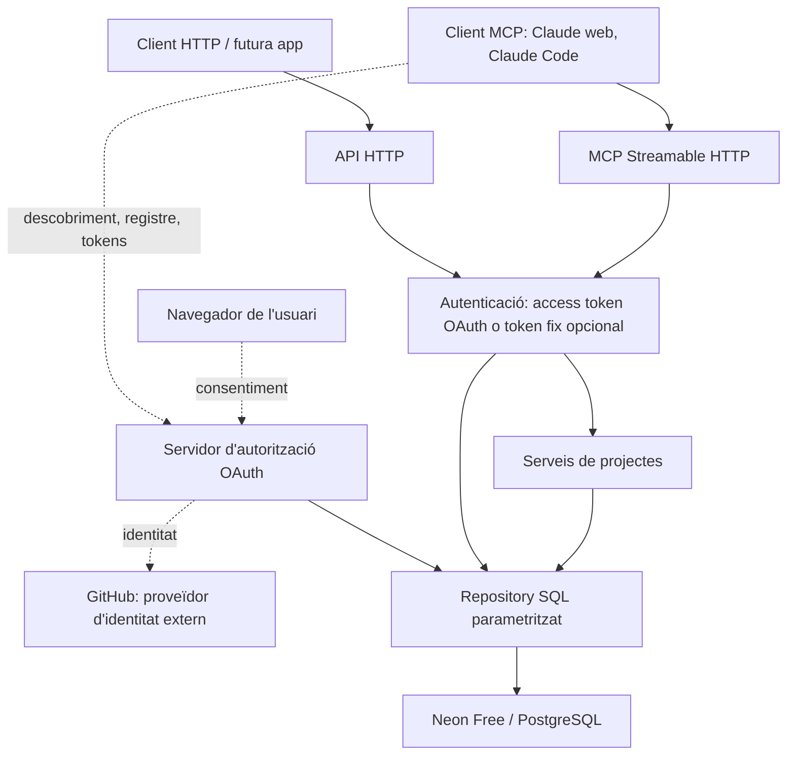

# Arquitectura mínima

**Aprovada:** D011–D014 i D023 (inici de sessió OAuth amb GitHub) a [DECISIONS](DECISIONS.md).
Evidència i limitacions a [CURRENT_STATE](CURRENT_STATE.md). Aquest document explica
l'estructura, no certifica desplegament: el codi OAuth (D023) està **implementat i provat
localment**, però el Worker públic encara no l'executa.

API, MCP, autenticació, servei, repository i servidor d'autorització viuen en un únic
Cloudflare Worker JavaScript. Jarvis fa dos papers: **servidor de recursos** (API i MCP,
que protegeixen les dades) i **servidor d'autorització** (emet els tokens que obren
aquestes dades). OAuth 2.1 és l'estàndard amb què un client obté permís d'accés sense
conèixer cap contrasenya; la identitat es delega a GitHub i Jarvis no guarda contrasenyes.
No hi ha ORM, framework HTTP, llibreria OAuth, gestió d'usuaris ni taula de rols: un sol
compte de GitHub admès. El SDK MCP oficial implementa el protocol. El driver Neon consulta
per HTTPS. No hi ha sessions MCP persistents, KV, Durable Objects ni estat de domini a memòria.

## Responsabilitats i flux

- `src/index.js`: límits d'entrada, comprovació d'origen/HTTPS i adaptador HTTP.
  Encamina les rutes OAuth abans de l'autenticació, afegeix `WWW-Authenticate` als 401
  i crea el repository només al primer ús (una petició rebutjada abans no obre BD).
- `src/oauth.js`: servidor d'autorització: metadades, registre de clients, pantalla de
  consentiment, anada i tornada de GitHub i endpoint de tokens.
- `src/tokens.js`: ajudants criptogràfics amb Web Crypto: SHA-256, HMAC-SHA-256 (signatura
  amb clau secreta), valors aleatoris, comparació en temps constant i JSON signat.
- `src/auth.js`: accepta un access token OAuth (`jvs_at_…`) o el token fix opcional;
  valida caducitat i retorna el propietari configurat.
- `src/mcp.js`: servidor i transport oficial, dues eines amb els mateixos serveis.
- `src/projects.js`: schemas estrictes, validació, empremta i resposta pública.
- `src/repository.js`: SQL compartit; Neon executa la creació dins una transacció explícita.
  Inclou el SQL d'`oauth_grants` (`grantOperations`), compartit per Neon i proves PostgreSQL.
- `migrations/001_projects.sql` i `002_oauth_grants.sql`: esquema revisable; no s'aplica
  a l'arrencada.
- `scripts/provision.js`, `db.js` i `database-ops.js`: preparació operativa,
  migració amb ledger i restauració acotada, sempre per ordres explícites.
- `scripts/oauth-setup.js`: prepara un fitxer privat amb la clau de signatura OAuth.
- `scripts/verify-neon.js`: comprovació API/MCP amb Neon des de Node sense publicar Worker.

Petició → comprovacions d'entrada → autenticació → servei → repository → PostgreSQL
→ resposta pública. API i MCP criden directament el servei; no es criden entre si.
El propietari, estat, IDs i dates mai són imposats pel client.

L'alta i l'estat d'idempotència comparteixen fila. El conflicte sobre propietari/clau
fa una actualització sense canvis i retorna la fila original sota bloqueig SQL.
El servei compara empremtes i retorna conflicte si el contingut és diferent.
Això funciona amb concurrència entre instàncies sense memòria compartida.
No actualitza `updated_at` en reintents. Sense clau, PostgreSQL admet múltiples NULL.

## Flux d'inici de sessió OAuth (D023, implementat, no desplegat)

Exemple: connectar Claude web a Jarvis. Contracte HTTP de cada pas a
[API_CONTRACT](API_CONTRACT.md); amenaces i proteccions a [SECURITY_PRIVACY](SECURITY_PRIVACY.md).

1. Claude crida `/mcp` sense token → 401 amb l'adreça de les metadades.
2. Claude llegeix les metadades i es registra a `/oauth/register` (DCR, registre dinàmic
   de clients) → rep un `client_id`. No es desa res: el `client_id` és el registre signat.
3. Claude obre el navegador a `/oauth/authorize` amb PKCE (Proof Key for Code Exchange):
   envia el hash (`code_challenge`, S256) d'un secret que només ell coneix.
4. Jarvis mostra una pantalla de **consentiment**: nom declarat pel client (no verificat)
   i host on s'entregarà l'accés.
5. L'usuari marca la casella de confirmació i prem «Continuar amb GitHub» → GitHub l'autentica → torna a `/oauth/callback`.
6. Jarvis canvia el codi de GitHub per un token, llegeix `GET https://api.github.com/user`
   i compara l'`id` numèric amb `GITHUB_ALLOWED_USER_ID`. El token de GitHub s'usa un cop
   i no es desa; no es demana cap scope.
7. Si coincideix, crea una fila a `oauth_grants` i redirigeix a Claude amb un codi d'un
   sol ús (60 s).
8. Claude canvia codi + `code_verifier` a `/oauth/token` → access token (1 h) i refresh
   token (30 dies).
9. Claude crida `/mcp` amb `Authorization: Bearer jvs_at_…`. Quan caduca, renova amb el
   refresh token; cada renovació en dona un de nou (rotació) i allarga 30 dies.

El propietari de les dades continua sent `DEV_OWNER_ID`: el login no crea usuaris.

## Decisions de simplicitat

SQL explícit i una sola taula de domini són suficients mentre no hi ha edició ni altres
operacions; `oauth_grants` només guarda connexions autoritzades. Una futura ampliació que canviï el projecte haurà de revisar la
semàntica de replay i la conservació de respostes; no està implementada ara.
Els ports de repository existeixen només com a objectes amb dues operacions,
sense jerarquia de classes ni repository genèric.

La [visió](PRODUCT_VISION.md) conserva app web, memòria, universitat, entrenaments,
integracions i proactivitat; les fases són al [roadmap](roadmap.md).
