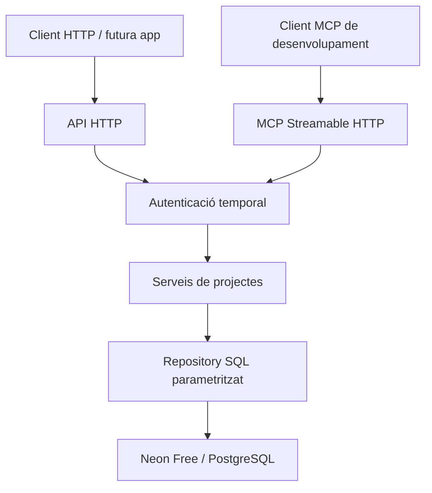

# Arquitectura mínima

**Aprovada:** D011–D014 a [DECISIONS](DECISIONS.md). Evidència i limitacions a
[CURRENT_STATE](CURRENT_STATE.md). Aquest document explica l'estructura, no certifica desplegament.

API, MCP, autenticació, servei i repository viuen en un únic Cloudflare Worker
JavaScript. No hi ha ORM, framework HTTP, servidor OAuth, gestió d'usuaris ni rols.
El SDK MCP oficial implementa el protocol. El driver Neon consulta per HTTPS.
No hi ha sessions MCP persistents, Durable Objects ni estat de domini a memòria.

## Responsabilitats i flux

- `src/index.js`: límits d'entrada, comprovació d'origen/HTTPS i adaptador HTTP.
- `src/auth.js`: valida credencial i caducitat; retorna el propietari configurat.
- `src/mcp.js`: servidor i transport oficial, dues eines amb els mateixos serveis.
- `src/projects.js`: schemas estrictes, validació, empremta i resposta pública.
- `src/repository.js`: SQL compartit; Neon executa la creació dins una transacció explícita.
- `migrations/001_projects.sql`: esquema inicial revisable; no s'aplica a l'arrencada.
- `scripts/provision.js`, `db.js` i `database-ops.js`: preparació operativa,
  migració amb ledger i restauració acotada, sempre per ordres explícites.
- `scripts/verify-neon.js`: comprovació API/MCP amb Neon des de Node sense publicar Worker.

Petició → comprovacions d'entrada → autenticació → servei → repository → PostgreSQL
→ resposta pública. API i MCP criden directament el servei; no es criden entre si.
El propietari, estat, IDs i dates mai són imposats pel client.

L'alta i l'estat d'idempotència comparteixen fila. El conflicte sobre propietari/clau
fa una actualització sense canvis i retorna la fila original sota bloqueig SQL.
El servei compara empremtes i retorna conflicte si el contingut és diferent.
Això funciona amb concurrència entre instàncies sense memòria compartida.
No actualitza `updated_at` en reintents. Sense clau, PostgreSQL admet múltiples NULL.

## Decisions de simplicitat

SQL explícit i una sola taula són suficients mentre no hi ha edició ni altres
operacions. Una futura ampliació que canviï el projecte haurà de revisar la
semàntica de replay i la conservació de respostes; no està implementada ara.
Els ports de repository existeixen només com a objectes amb dues operacions,
sense jerarquia de classes ni repository genèric.

La [visió](PRODUCT_VISION.md) conserva app web, memòria, universitat, entrenaments,
integracions i proactivitat; les fases són al [roadmap](roadmap.md).
