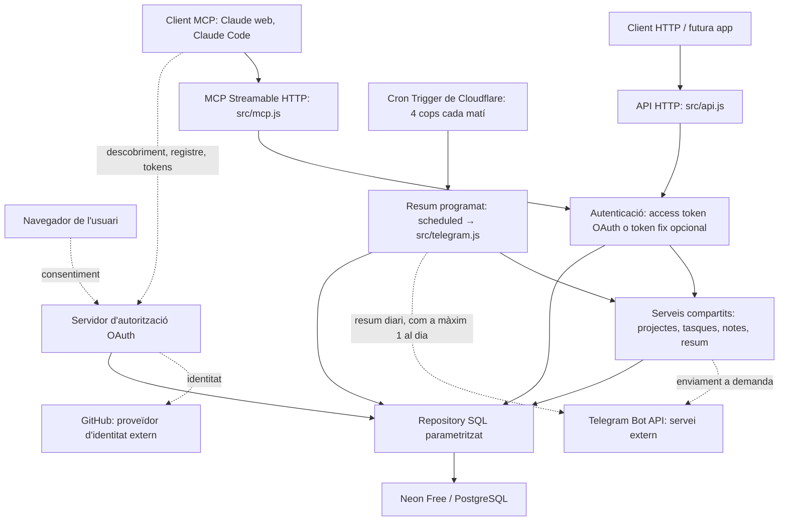

# Arquitectura mínima

**Aprovada:** D011–D014, D023 (inici de sessió OAuth amb GitHub) i D024–D026 (projectes,
tasques, notes, resum diari, Telegram i còpia format 2) a [DECISIONS](DECISIONS.md).
Evidència i limitacions a [CURRENT_STATE](CURRENT_STATE.md). Aquest document explica
l'estructura, no certifica desplegament. El codi OAuth (D023) està publicat al Worker
des del 2026-11-24 i verificat amb Claude web/app. El codi de D024–D026 està
**implementat i provat localment** (simuladors i PostgreSQL local), però **no desplegat**:
el Worker públic continua exposant només les 2 eines de D023.

API, MCP, autenticació, serveis, repository, servidor d'autorització i tasca programada
viuen en un únic Cloudflare Worker JavaScript. Jarvis fa dos papers: **servidor de
recursos** (API i MCP, que protegeixen les dades) i **servidor d'autorització** (emet els
tokens que obren aquestes dades). OAuth 2.1 és l'estàndard amb què un client obté permís
d'accés sense conèixer cap contrasenya; la identitat es delega a GitHub i Jarvis no guarda
contrasenyes. No hi ha ORM, framework HTTP, llibreria OAuth, gestió d'usuaris ni taula de
rols: un sol compte de GitHub admès. El SDK MCP oficial implementa el protocol. El driver
Neon consulta per HTTPS. No hi ha sessions MCP persistents, KV, Durable Objects ni estat de
domini a memòria. Telegram és l'únic servei extern al qual Jarvis **escriu**, i només si
hi ha secrets configurats.

## Responsabilitats i flux

- `src/index.js`: límits d'entrada, comprovació d'origen/HTTPS i adaptador HTTP.
  Encamina les rutes OAuth abans de l'autenticació, afegeix `WWW-Authenticate` als 401,
  crea el repository només al primer ús (una petició rebutjada abans no obre BD), envia
  `/mcp` a `mcp.js` i la resta a `api.js`. També exporta `scheduled`, que crida el cron.
- `src/api.js`: adaptador HTTP de les rutes `/api/v1/…` cap als serveis.
- `src/mcp.js`: servidor i transport oficial; registre de les 13 eines sobre els mateixos serveis.
- `src/services.js`: munta tots els serveis sobre un sol repository i afegeix la vista
  conjunta d'un projecte (`overview`).
- `src/validation.js`: regles d'entrada compartides (UUID, prioritat, `limit`, dates de
  calendari) i càlcul de la data i l'hora de Madrid.
- `src/projects.js`, `src/tasks.js`, `src/notes.js`: schemas estrictes, validació,
  empremta d'idempotència i resposta pública de cada entitat.
- `src/summary.js`: resum diari per regles i plantilles, sense IA.
- `src/telegram.js`: enviament a Telegram (a demanda i programat) amb el registre diari.
- `src/oauth.js`: servidor d'autorització: metadades, registre de clients, pantalla de
  consentiment, anada i tornada de GitHub i endpoint de tokens.
- `src/tokens.js`: ajudants criptogràfics amb Web Crypto: SHA-256, HMAC-SHA-256 (signatura
  amb clau secreta), valors aleatoris, comparació en temps constant i JSON signat.
- `src/auth.js`: accepta un access token OAuth (`jvs_at_…`) o el token fix opcional;
  valida caducitat i retorna el propietari configurat.
- `src/repository.js`: SQL de creació/lectura de projectes (Neon executa la creació dins
  una transacció explícita) i d'`oauth_grants` (`grantOperations`); munta el repository Neon.
- `src/domain-repository.js`: SQL de llistats, edicions, tasques, notes i registre del
  resum diari, compartit per Neon i les proves PostgreSQL.
- `migrations/001_projects.sql`, `002_oauth_grants.sql` i `003_tasks_notes_summary.sql`:
  esquema revisable; no s'aplica a l'arrencada.
- `scripts/provision.js`, `db.js` i `database-ops.js`: preparació operativa,
  migració amb ledger, permisos runtime, còpia format 2 i restauració acotada, sempre per
  ordres explícites.
- `scripts/oauth-setup.js`: prepara un fitxer privat amb la clau de signatura OAuth.
- `scripts/telegram-setup.js`: prepara el fitxer privat amb el token del bot i desa el
  `chat_id` (`npm run telegram:setup` i `telegram:chat`).
- `scripts/verify-neon.js`: comprovació API/MCP amb Neon des de Node sense publicar Worker.

Petició → comprovacions d'entrada → autenticació → servei → repository → PostgreSQL
→ resposta pública. API i MCP criden directament els mateixos serveis de `services.js`;
no es criden entre si. Per això les dues vies no poden discrepar en regles ni en propietari.
El propietari, l'estat inicial, els IDs i les dates del servidor mai són imposats pel client.

L'alta i l'estat d'idempotència comparteixen fila. **Idempotència** vol dir que repetir la
mateixa petició amb la mateixa clau no crea un segon registre. El conflicte sobre
propietari/clau fa una actualització sense canvis i retorna la fila original sota bloqueig
SQL. El servei compara empremtes i retorna conflicte si el contingut és diferent.
Això funciona amb concurrència entre instàncies sense memòria compartida.
No actualitza `updated_at` en reintents. Sense clau, PostgreSQL admet múltiples NULL.
Projectes, tasques i notes segueixen el mateix patró.

### Cada escriptura és una sola sentència SQL

El driver HTTP de Neon envia cada consulta per separat i no ofereix **transaccions
interactives** (obrir una transacció, fer diverses consultes amb lògica entremig i
confirmar-la al final). Per això cada operació de `domain-repository.js` és **una sola
sentència**: PostgreSQL garanteix que una sentència s'aplica sencera o no s'aplica.

Quan cal tocar dues taules alhora es fa servir una **CTE** (*Common Table Expression*,
un bloc `WITH nom AS (…)` que funciona com un pas intermedi dins la mateixa sentència).
Exemple: crear una tasca dins el projecte «Bici» ha d'actualitzar `last_activity_at` del
projecte. `CREATE_TASK` primer fa `UPDATE projects … WHERE id = $projecte AND owner_id =
$propietari` dins el `WITH` i després només insereix la tasca si aquest pas ha trobat el
projecte. Si el projecte no existeix o és d'un altre propietari, no s'insereix res i el
servei respon `project_not_found`. Mai queda una tasca sense activitat registrada ni
una activitat sense tasca.

### Aïllament per propietari, dues vegades

1. **A les consultes**: totes les sentències filtren per `owner_id`, que surt del token,
   mai del client.
2. **A la BD**: tasques i notes apunten al projecte amb una **clau forana composta**
   `(project_id, owner_id)` → `projects (id, owner_id)`. Una clau forana és una regla
   de la BD que impedeix apuntar a una fila que no existeix; en ser composta, la fila ha
   de tenir també el mateix propietari. Encara que una consulta tingués un error, la BD
   rebutjaria lligar una tasca al projecte d'un altre propietari.

Detall de taules i permisos a [DATA_MODEL](DATA_MODEL.md).

### Resum diari programat (D025, implementat, no desplegat)

Un **Cron Trigger** de Cloudflare és una ordre perquè la plataforma desperti el Worker a
hores fixes (`30 5-8 * * *` a `wrangler.jsonc`: 05:30, 06:30, 07:30 i 08:30 UTC). Les
hores del cron són UTC i UTC no té canvi d'hora; Madrid sí (UTC+1 a l'hivern, UTC+2 a
l'estiu). Per això el Worker es desperta quatre cops i decideix ell mateix:

1. Sense `TELEGRAM_BOT_TOKEN`, `TELEGRAM_CHAT_ID` o `DEV_OWNER_ID` vàlids, no fa res ni toca la BD.
2. Si a Madrid encara no són les `SUMMARY_HOUR` (6, 7 o 8; 7 per defecte o si el valor no és
   vàlid), s'espera al següent despertar.
3. **Reclama** el dia a la taula `summary_runs` (registre o *ledger*, una fila per
   propietari i dia). Només qui aconsegueix la fila envia; els despertars següents
   s'aturen aquí.
4. Calcula el resum. Si no hi ha res a dir, desa `skipped` i no envia res; si no, l'envia
   i desa el resultat. Només es reintenta (`failed`, fins a 3 intents al dia) quan Telegram
   respon amb un error, és a dir, quan és segur que no s'ha entregat. Si no hi ha resposta
   (per exemple, un timeout) queda `unknown` i no es torna a enviar: podria haver arribat.

Si el Worker s'atura entre reclamar i enviar, la fila queda `sending` i aquell dia no
s'envia: es prefereix cap missatge a un duplicat. Regles del resum a
[AUTOMATIONS](AUTOMATIONS.md). El Cron Trigger real **no està verificat**.

## Flux d'inici de sessió OAuth (D023, desplegat, verificat amb Claude web/app)

Exemple: connectar Claude web a Jarvis. Contracte HTTP de cada pas a
[API_CONTRACT](API_CONTRACT.md); amenaces i proteccions a [SECURITY_PRIVACY](SECURITY_PRIVACY.md).

1. Claude crida `/mcp` sense token → 401 amb l'adreça de les metadades.
2. Claude llegeix les metadades i es registra a `/oauth/register` (DCR, registre dinàmic
   de clients) → rep un `client_id`. No es desa res: el `client_id` és el registre signat.
3. Claude obre el navegador a `/oauth/authorize` amb PKCE (Proof Key for Code Exchange):
   envia el hash (`code_challenge`, S256) d'un secret que només ell coneix.
4. Jarvis mostra una pantalla de **consentiment**: nom declarat pel client (no verificat)
   i host on s'entregarà l'accés.
5. L'usuari marca la casella de confirmació i prem «Continuar amb GitHub» → GitHub l'autentica → torna a `/oauth/callback`.
6. Jarvis canvia el codi de GitHub per un token, llegeix `GET https://api.github.com/user`
   i compara l'`id` numèric amb `GITHUB_ALLOWED_USER_ID`. El token de GitHub s'usa un cop
   i no es desa; no es demana cap scope.
7. Si coincideix, crea una fila a `oauth_grants` i redirigeix a Claude amb un codi d'un
   sol ús (60 s).
8. Claude canvia codi + `code_verifier` a `/oauth/token` → access token (1 h) i refresh
   token (30 dies).
9. Claude crida `/mcp` amb `Authorization: Bearer jvs_at_…`. Quan caduca, renova amb el
   refresh token; cada renovació en dona un de nou (rotació) i allarga 30 dies.

El propietari de les dades continua sent `DEV_OWNER_ID`: el login no crea usuaris.

## Decisions de simplicitat

SQL explícit i poques taules de domini (`projects`, `tasks`, `notes`) més dues d'estat
operatiu (`oauth_grants`, `summary_runs`). Res no s'esborra: projectes i tasques
s'arxiven o es cancel·len i les notes es desactiven. No hi ha taula d'esdeveniments,
cua ni repository genèric: els ports de repository són objectes amb funcions SQL
concretes, sense jerarquia de classes. Les edicions no són idempotents per clau: tornar
a enviar el mateix canvi deixa el mateix resultat, però actualitza `updated_at`.

La [visió](PRODUCT_VISION.md) conserva app web, universitat, entrenaments, calendari,
integracions i Telegram bidireccional; les fases són al [roadmap](roadmap.md).
