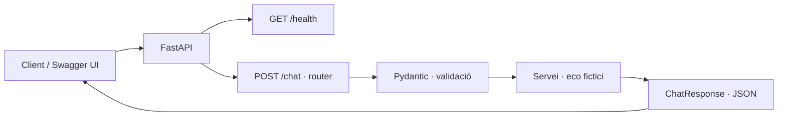
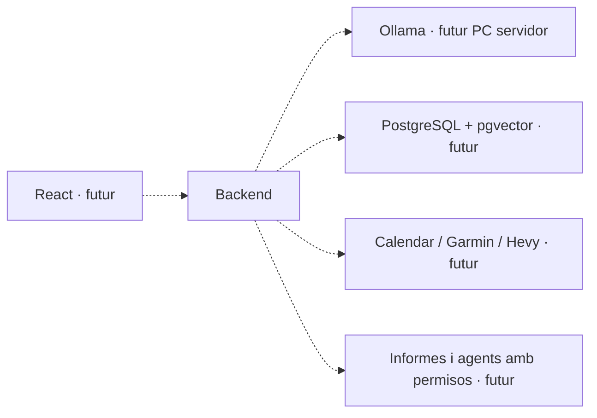

# Visió general

JARVIS és un monòlit modular: un sol procés desplegable amb responsabilitats
separades en mòduls Python. Evita haver de gestionar xarxa, desplegaments i
errors distribuïts entre microserveis quan encara estem aprenent el domini.

## Implementat

FastAPI exposa salut i xat. El xat valida un missatge i genera un eco.
No desa missatges ni fa peticions externes.

## Planificat, sense implementar

Les línies discontínues representen plans, no connexions existents.
El Mac serveix per desenvolupar; el PC Windows podrà allotjar models locals.
La ubicació física dels serveis futurs no altera ara l'estructura del backend.
